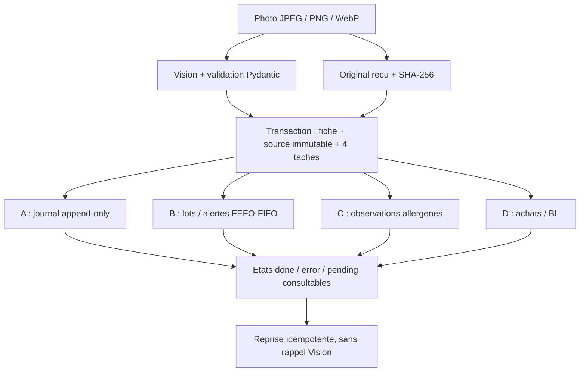

# Pipeline de reception fournisseur HACCP

## Perimetre et limites sanitaires

Une capture **Reception** alimente quatre tables distinctes dans `haccp.sqlite3`.
Le stock est un registre de **lots recus a controler**, independant de THEMIS :
FEFO (echeance la plus proche), puis FIFO a echeance egale, alerte **48 heures**
avant l'echeance. Une date inconnue impose une verification immediate.
Une DLC depassee bloque l'etiquette d'utilisation ; une DDM n'est pas assimilee
a une DLC. Aucun jour, pays d'origine ou poids manquant n'est invente.

La photo ne mesure ni la temperature, ni les quantites effectivement livrees,
ni l'etat physique ou la chaine du froid. Le poids net lu est celui de
l'etiquette, pas une quantite disponible en magasin. Les receptions physiques,
quantites, mouvements de sortie et rapprochements comptables ne sont pas
automatiquement valides par ce pipeline.

Les allergenes sont des **observations fournisseurs**, pas une certification
d'absence ni une mise a jour de la carte. La matrice historique des plats
et le stock THEMIS restent inchanges. Le drapeau `conforme_reception` porte
sur la lecture : il ne constitue pas un avis de conformite DDPP. Les mentions
obligatoires, dont les origines selon le produit, restent a verifier par un
operateur competent dans le cadre du PMS.

## Architecture



| Fichier | Responsabilite |
|---|---|
| [schemas/haccp.py](../backend/schemas/haccp.py) | Champs Vision stricts, origines, poids decimal, presences et traces separees |
| [schemas/haccp_reception.py](../backend/schemas/haccp_reception.py) | Source versionnee, preuve image, declaration d'ouverture |
| [services/haccp_vision.py](../backend/services/haccp_vision.py) | Appel Vision, validation et lecture partielle explicite |
| [services/haccp_images.py](../backend/services/haccp_images.py) | Formats reels, limite 20 Mio et 25 millions de pixels |
| [services/haccp_records.py](../backend/services/haccp_records.py) | Transaction commune fiche/source/outbox et capture idempotente |
| [services/haccp_reception.py](../backend/services/haccp_reception.py) | Archivage brut, quatre projections, reprise et controle d'integrite |
| [models/haccp_reception.py](../backend/models/haccp_reception.py) | Tables de source, de distribution et des quatre destinations |
| [haccp_database.py](../backend/haccp_database.py) | Migration additive, cles etrangeres, transactions et triggers |
| [routers/haccp_reception.py](../backend/routers/haccp_reception.py) | Consultation privee, original, reprise et ouverture explicite |
| [HaccpReceptions.jsx](../frontend/src/HaccpReceptions.jsx) | Parcours **Receptions / Lots**, quatre vues et deconditionnement |

### Contrat de lecture

`EtiquetteVisionOutput` contient :

- produit, fournisseur **ou marque** lu, numero de lot et estampille sanitaire ;
- DLC/DDM complete et son type, consigne de stockage d'origine ;
- pays de naissance, elevage (liste), abattage et decoupe, sans les deduire
  du code `FR` de l'estampille ;
- poids net decimal positif avec unite `kg` ou `g`, serialise sans conversion
  en nombre flottant ;
- les 14 groupes d'allergenes du schema existant, leurs traces possibles
  separees, et la mention de traces originale ;
- `allergenes_lecture` (`non_verifiee`, `partielle`, `complete`),
  `champs_incertains` et commentaire d'anomalie.

Le serveur ajoute `date_scan` UTC, etablissement, operateur declare, chemin,
type MIME, taille et empreinte de l'image. Le modele ne choisit pas ces
metadonnees ni un chemin de fichier.

Un JSON structure recuperable peut devenir une **lecture partielle** :
les champs invalides sont marques incertains, les allergenes canoniques
encore lisibles et les origines valides sont conserves, le reste reste
inconnu. La fiche n'est pas validee pour l'utilisation. Un JSON vide,
incomprehensible, tronque ou contenant des champs interdits, une configuration
absente ou une panne du fournisseur restent des erreurs explicites.
Une liste d'allergenes vide ne signifie jamais « sans allergene ».

### Quatre destinations, pas une transaction globale fragile

1. **A — `haccp_reception_journal`** : une entree par reception, horodatage
   d'inscription, source complete, sequence et chaine SHA-256 par compte
   ou entreprise. UPDATE, DELETE et remplacement par INSERT OR REPLACE
   sont refuses par des triggers. La source durable est protegee de meme.
2. **B — `haccp_stock_lots`** : lot, poids net **declare**, echeance et
   date d'alerte. Une date seule est bornee au dernier instant du jour en
   Europe/Paris. Le delai de 48 h est en heures ecoulees, y compris au
   changement d'heure. Une alerte deja due au scan demarre immediatement.
   Les dates inconnues sont signalees et placees apres les echeances connues
   dans la liste FEFO ; cela ne les rend pas utilisables.
3. **C — `haccp_allergen_observations`** : comparaison avec la derniere
   source anterieure comparable du meme etablissement, produit et
   fournisseur/marque. L'identite est comparee sans tenir compte de la casse
   et des espaces multiples, mais sans rapprochement approximatif.
   Les nouvelles presences, y compris le passage de trace a presence,
   et les nouvelles traces declenchent une alerte.
   Cette alerte apparait aussi dans le resultat du scan, meme si les quatre
   distributions techniques ont reussi.
   Identite incertaine, lecture partielle ou premiere observation :
   verification requise, pas de fausse absence d'allergene.
4. **D — `haccp_purchase_receipts`** : produit, fournisseur/marque declare,
   poids, lot et preuve, statut `a_rapprocher`. Ni BL, ni prix, ni facture,
   ni fournisseur commercial confirme ne sont inventes.

La source et les quatre lignes de `haccp_reception_deliveries` sont creees
dans la **meme transaction** que la fiche de reception. Ensuite chaque
destination utilise sa propre transaction SQLite `BEGIN IMMEDIATE` :
la projection et son etat `done` sont valides ensemble. Une erreur connue
annule les ecritures de cette seule destination et conserve son etat `error`.
Une interruption laisse une tache reprenable. Une erreur de base qui empeche
meme de sauvegarder cet etat est signalee au client, jamais masquee.

Les cles uniques par reception/destination et les verrous SQLite couvrent
plusieurs processus, pas seulement plusieurs threads. Une reprise ne
reexecute pas les destinations terminees et ne rappelle pas Vision.
La comparaison allergenes utilise l'ordre des sources archivees, non l'ordre
dans lequel leurs taches ont ete reprises. L'interface distingue archivage
de la fiche, etat de distribution et controle sanitaire.

### Archivage de l'original

Tous les chemins persistants passent par `runtime_paths.data_dir()`.
L'original est conserve sous :

```text
receptions/<empreinte-perimetre>/<identifiant-tentative>/
  REC_<FOURNISSEUR>_<YYYYMMDDTHHMMSSZ>_<LOT>.ext
```

Fournisseur et lot sont assainis et bornes a 16 caracteres dans le nom :
leurs valeurs completes restent dans la source. Une valeur non lue devient
`NON_LU` **dans le nom seulement**. Chaque tentative a son propre dossier.
Publication par fichier temporaire, `flush`/`fsync`, puis lien atomique sans
ecrasement. Le systeme de fichiers doit prendre en charge les liens physiques
(par exemple NTFS ou ext4) ; sinon l'archivage echoue explicitement.
Les sous-dossiers d'archive rediriges par lien ou jonction sont refuses.
Pour choisir un autre emplacement, configurer `SIRIUS_DATA_DIR`.

« Original » signifie **octets recus par l'API** : la camera web les a deja
encodes en JPEG. L'ancien apercu JPEG normalise reste disponible separement ;
il ne remplace jamais cette preuve brute. Le telechargement authentifie
reverifie la taille et le SHA-256 et sert les octets verifies.

Un echec avant commit nettoie seulement les fichiers propres a la tentative.
Un commit retrouve conserve ses preuves. Si l'etat du commit est inconnu,
les fichiers sont conserves et une erreur est journalisee, plutot que de
supprimer une preuve potentiellement referencee.
Un arret brutal entre publication du fichier et commit peut laisser un
fichier non reference : ne pas le purger automatiquement sans rapprochement
avec la base et sauvegarde. SQLite et le systeme de fichiers ne constituent
pas une transaction distribuee.

### Ce que garantit — et ne garantit pas — le journal

Les triggers empechent les modifications applicatives ordinaires. La chaine
et les empreintes detectent les ruptures, certaines modifications de la base
et les images absentes ou modifiees. Ce n'est **pas** un stockage WORM certifie,
une signature qualifiee ou une protection contre un administrateur capable
de modifier les triggers, les donnees et toutes les empreintes.

Faire des sauvegardes coherentes de **la base et de ses images**, tester leur
restauration et conserver des empreintes de fin de chaine sur un support
independant/protege selon la politique de l'etablissement. Aucune sauvegarde
distante ou politique de retention n'est configuree automatiquement ici.
Les autres fichiers SQLite de SIRIUS n'incluent pas ce registre.

Pour verifier un export du journal, la formule utilise SHA-256 sur le JSON
canonique UTF-8 d'une liste :

```text
[empreinte_perimetre, sequence, previous_hash, recorded_at_UTC_ISO, source_JSON_canonique]
```

JSON canonique : cles triees, `ensure_ascii=False`, separateurs `,` et `:`,
pas de NaN. Le dernier element est une **chaine JSON**, pas un objet.
La premiere empreinte precedente vaut 64 zeros.
`recorded_at` est exporte avec le decalage `+00:00`.
La version 1 de la source est un contrat d'archive : une evolution doit
conserver sa lecture et ses octets, pas reecrire les anciennes preuves.

## API et interface

Tous ces endpoints utilisent le meme controle authentifie utilisateur /
entreprise et la permission HACCP que le scanner. Un PC en mode relais
transmet ces operations au Cloud ; une panne Cloud ne cree pas de copie
locale de remplacement.

| Methode | Endpoint sous `/api/haccp` | Usage |
|---|---|---|
| POST | `/etiquettes/scan` | Capture existante ; active le pipeline en mode reception |
| GET | `/receptions` | Nouvelles receptions et etats de distribution |
| GET | `/receptions/destinations/{destination}` | `traceabilite`, `stock`, `allergenes`, `achats` |
| GET | `/receptions/{id}/distribution` | Etat des quatre destinations |
| POST | `/receptions/{id}/reprise` | Reprise sans nouvelle photo ni lecture Vision |
| GET | `/receptions/{id}/original` | Original prive verifie, avec en-tete `X-HACCP-SHA256` |
| GET | `/receptions/integrite` | Controle pagine du journal et de ses images |
| POST | `/receptions/{id}/ouverture` | Declaration explicite d'ouverture depuis la preuve recue |

Listes : `offset`, `limit` (1 a 100, defaut 25) et `restaurant_name` facultatif.
Integrite : defaut 20 entrees par page ; `ok` concerne la page.
Parcourir `prochain_offset` jusqu'a `null` pour couvrir tout le journal du
compte/entreprise. L'interface le fait et refuse d'annoncer un controle
complet si la taille du journal change pendant cette lecture.
Le controle n'inclut pas les anciennes fiches anterieures au pipeline.

Dans **Receptions / Lots**, consulter chaque destination, ouvrir une fiche,
reprendre les destinations en echec et telecharger l'original.
La fiche selectionnee est amenee a l'ecran. Reprendre ou actualiser sa
distribution met aussi a jour la liste, sans effacer l'ouverture en cours de saisie.
Un scan reussi avec distribution partielle reste visible et reprenable.
Le registre historique et son CSV restent disponibles ; les nouvelles
colonnes d'origines, poids, traces et preuve brute y sont ajoutees.
Les anciennes listes melangeant presences/traces ne sont pas requalifiees.

### Deconditionnement et impression

La reception n'est **jamais** consideree comme une ouverture. L'action
explicite « Ouvrir ou decouper maintenant » propose 72 h a modifier,
sans confirmation ni reference PMS pre-remplies.
Le serveur exige une duree entiere positive, la reference fabricant/PMS,
l'operateur et les confirmations `regle_confirmee` / `ouverture_effectuee`.
Il utilise l'instant reel de declaration, borne la DLC secondaire par
la DLC d'origine et refuse une source incertaine, perimee ou alteree.

La nouvelle fiche d'ouverture reference la reception et sa preuve, sans
creer une seconde entree de stock ni refaire l'analyse. Son `capture_id`
UUID rend les retries idempotents. Apres perte de reponse, conserver les
memes donnees et UUID ; consulter le registre avant toute autre tentative.
Les confirmations et l'anti-doublon d'impression Windows / Android existants
sont reutilises. Aucune impression n'est declenchee par la distribution.

## Exemple complet, sans reseau ni imprimante

Depuis `backend` avec l'environnement Python du projet :

```powershell
& '..\.venv\Scripts\python.exe' -m haccp_reception_demo
# Pour conserver les fichiers, choisir un dossier qui n'existe pas :
& '..\.venv\Scripts\python.exe' -m haccp_reception_demo --output 'C:\Temp\SIRIUS-HACCP-DEMO'
```

[L'exemple executable](../backend/haccp_reception_demo.py) utilise une image
de viande **fictive**, remplace le client Vision par une simulation et appelle
la vraie API en memoire. Il ne demarre aucun serveur accessible sur le reseau
et n'utilise aucune cle reelle.

Il simule deux lots, une panne apres insertion du stock du premier lot,
une reprise sans doublon et l'apparition de **Moutarde** sur le second.
Il genere une etiquette HTML d'ouverture marquee TEST, sans l'imprimer.
Les 72 h et la consigne de stockage de cet exemple sont fictives :
**ce ne sont pas une recommandation pour conserver de la viande**.

Resultats attendus : deux lectures Vision simulees, deux entrees dans chacune
des quatre destinations, aucune ecriture dupliquee, alerte Moutarde et
controle d'integrite positif. Le message d'erreur de stock dans les journaux
est volontaire ; le rapport final confirme sa reprise.

Sorties : `A-traceabilite.jsonl`, `B-stock.json`,
`C-observations-allergenes.json`, `D-achats.json`, images, base SQLite et
`etiquette-ouverture-TEST.html`. Sans `--output`, le dossier temporaire est
nettoye. Avec cette option, aucun dossier existant n'est ecrase.

Les tests couvrent notamment les lectures partielles, les 48 h exactes,
FEFO/FIFO, la concurrence entre processus, les reprises apres panne,
les permissions, le relais, les migrations et le parcours de deconditionnement.
Un essai camera/IA/imprimante reel et une validation PMS restent necessaires
avant usage en service.
