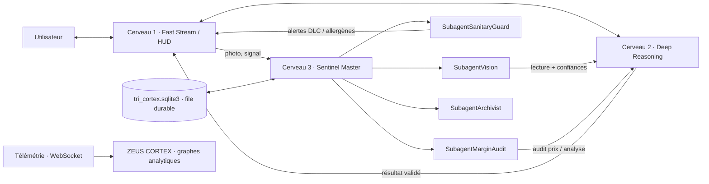

# Tri-Cortex : Cerveau 1, Cerveau 2 et Sentinel Master

Tri-Cortex sépare le dialogue, la logique métier et le travail de fond de ΣIRIUS.
Le Cerveau 1 et le Cerveau 2 sont des **appels directs**, sans worker ni file. Le
Cerveau 3, le **Sentinel Master**, supervise quatre subagents `asyncio` qui
consomment une file durable SQLite. Trois graphes analytiques de **ZEUS CORTEX**,
un par cerveau, affichent leur activité réelle.

Les transports IA existants sont conservés : Cerebras/Groq pour le dialogue
rapide, Kimi pour le mode profond et OpenAI pour Vision. Tri-Cortex ne change
ni les clés ni les modèles configurés. Le temps jusqu'au premier fragment
est mesuré pendant le streaming ; aucun délai fournisseur n'est garanti.

Ce que Tri-Cortex **ne fait pas** :

- aucune validation sanitaire, réglementaire ou comptable automatique : toute
  lecture Vision reste un brouillon à contrôler par une personne ;
- aucune modification de recette, de carte, de stock physique ou d'écriture comptable ;
- aucune purge d'original : seules les copies et les fichiers temporaires connus
  sont nettoyés ;
- aucune garantie d'exécution « exactement une fois » chez un fournisseur d'IA
  après un délai dépassé ou un arrêt brutal : la reprise est « au moins une fois »,
  protégée par des clés d'idempotence.

## Architecture



| Composant | Rôle | Exécution |
|---|---|---|
| `Brain1FastStream` | Réponse et flux de dialogue, temps jusqu'au premier fragment, publication HUD | Direct, dans la requête |
| `Brain2DeepReasoning` | Contrôles HACCP des lectures, cohérence HT/TVA/TTC des factures, variation de prix, coût matière, marge et point mort | Direct ; calculs synchrones en thread |
| `Brain3SentinelMaster` | Démarre/arrête l'escouade, heartbeat (1 s), redistribution des tâches dues, relance des workers | Arrière-plan |
| `SubagentVision` | Lecture d'étiquette ou de facture, confiance par champ, puis Cerveau 2 → Cerveau 1 | File Sentinel |
| `SubagentSanitaryGuard` | DLC expirée, rotation ≤ 48 h, date inconnue, lecture non conforme, allergènes à vérifier | File Sentinel |
| `SubagentMarginAudit` | Audit des prix fournisseurs confirmés ; héberge l'unique ordonnanceur financier existant | File Sentinel |
| `SubagentArchivist` | Copies JPEG compressées, purge des caches, lecture des tâches hors ligne dues | File Sentinel |
| `TriCortexOrchestrator` | Assemble les trois cerveaux, le bus d'événements et la télémétrie | Cycle de vie FastAPI |

### Chaîne opérationnelle Vision → Cerveau 2 → Cerveau 1

1. Le scanner HACCP ou `POST /api/cortex/tri/vision` stocke l'image dans la file
   avec son SHA-256, puis crée une tâche idempotente (`scope`, type, clé de requête).
2. `SubagentVision` relit l'image depuis SQLite, vérifie son empreinte et appelle
   le transport Vision existant (`gpt-4o-mini`, délai de 30 s, sans nouvel essai SDK).
3. Le Cerveau 2 revalide la lecture avec les règles HACCP existantes. Une confiance
   absente, illisible ou portant sur un champ incertain reste **inconnue** (`null`).
4. Le Cerveau 1 publie le résultat sur le HUD. Le résultat durable porte
   `requires_human_review=true` et `confidence_method="model_self_report_not_calibrated"`.

Dans le scanner, la sauvegarde de réception existante reste inchangée : source
canonique v1, original SHA-256 et quatre destinations. Les scores de confiance
restent dans le résultat Cortex, jamais dans la preuve HACCP archivée. Si une
analyse reprise est utilisée plus tard, le Cerveau 2 recontrôle la DLC à la date
d'utilisation.

## Les deux agents du Cerveau 1

Le Cerveau 1 répartit chaque requête vers **un seul** agent, selon le point d'entrée :

| Agent | Point d'entrée | Travail | Ce qu'il ne fait jamais |
|---|---|---|---|
| **HERMÈS · Aiguilleur** | `/api/intent` | Comprend une commande et renvoie l'action d'interface : ouvrir, fermer ou réduire un module, briefing, musique… | Converser ou rédiger une réponse longue |
| **IRIS · Messagère** | `/api/chat`, `/api/chat/stream` | Rédige les réponses parlées et le texte de ΣIRIUS Display, avec la mémoire et l'historique | Exécuter une action d'interface ou ouvrir un module |

Garde-fou anti-doublons (`RequestGuard`) :

- La clé d'une requête combine l'agent, l'utilisateur, la tâche, le texte normalisé
  (minuscules, sans accents ni ponctuation, sans « Zirius » au début) et toutes les options
  qui changent la réponse (session, profil, mémoire, modes, environnement). Les valeurs
  des clés API sont représentées par des empreintes HMAC temporaires au processus : elles
  ne sont ni stockées ni journalisées.
- Une requête identique **déjà en cours** rejoint le même traitement : un seul appel IA,
  une seule écriture d'historique, un seul décompte de quota.
- `/api/chat` et `/api/chat/stream` partagent le même garde-fou IRIS : un doublon entre les
  deux modes de réponse reste silencieux et ne déclenche pas un second appel IA.
- Une requête identique reçue juste après reprend le résultat : pendant 3 s pour HERMÈS
  et 4 s pour IRIS. En flux, le doublon reçoit une réponse silencieuse (`ignored`).
- Un échec ou une coupure n'est jamais mis en cache : une nouvelle tentative repart.
- Les compteurs « Doublons bloqués », durées, réussites et échecs de chaque agent sont
  publiés dans `brain1_agents` de la trame et affichés dans ZEUS CORTEX.

Un troisième agent pourra être ajouté au même modèle (`Brain1AgentSpec`) si les essais de
fluidité le justifient.
## Cycle de vie et isolation des pannes

`BaseSubAgent` fournit `start`, `stop`, `restart_on_failure`, une `asyncio.Queue`
bornée et des métriques. SQLite reste la source de vérité ; la queue mémoire ne
contient que des identifiants.

- Chaque traitement est réautorisé juste avant exécution : compte actif,
  appartenance, permission HACCP, rôle admin/manager pour la finance, licence.
- Délai maximal de 120 s par traitement ; lease SQLite de 270 s.
- Erreur fournisseur ou d'E/S : nouvel essai avec délai exponentiel, trois
  tentatives au total. Erreur métier attendue : échec enregistré, sans relance.
- Erreur inattendue : tâche en échec et worker arrêté. Sentinel le relance au plus
  trois fois par minute, avec un délai croissant plafonné à 30 s.
- Une panne de subagent ne touche ni le Cerveau 1 ni le Cerveau 2 ; un échec de
  démarrage SQLite laisse aussi les Cerveaux 1 et 2 disponibles, le Cerveau 3
  apparaissant `failed`.
- Une tâche altérée dans SQLite (empreinte ou contrat invalide) est mise en
  quarantaine en `failed`, sans boucle de redémarrage.
- Capacité de 64 tâches non terminées par subagent ; au-delà, la demande est
  refusée explicitement (HTTP 503), sans perte silencieuse.
- `POST /jobs/{id}/retry` relance manuellement une tâche en échec, sous les
  mêmes contrôles de droits et de capacité.

La file est **côté serveur**. Une photo jamais transmise depuis un téléphone hors
réseau n'est pas enregistrée par Tri-Cortex.

## Télémétrie ZEUS CORTEX

Le flux est une `CortexFrame` JSON, version 1, émise environ chaque seconde :

```json
{
  "version": 1, "runtime_id": "…", "sequence": 42, "source": "local",
  "emitted_at": "2026-11-02T21:30:01Z", "heartbeat_at": "2026-11-02T21:30:01Z",
  "nodes": [
    {"id": "brain_1", "parent": null, "status": "idle", "pulse_level": 0.0, "first_token_ms": 52.1, "…": "…"},
    {"id": "brain_2", "parent": null, "status": "idle", "pulse_level": 0.0, "…": "…"},
    {"id": "brain_3", "parent": null, "status": "busy", "pulse_level": 0.25, "queued": 0, "…": "…"}
  ],
  "satellites": [
    {"id": "vision", "parent": "brain_3", "status": "busy", "pulse_level": 1.0, "current_task": "vision_label",
     "latency_ms": null, "queued": 0, "completed": 0, "failures": 0, "restarts": 0, "load": 1.0, "first_token_ms": null},
    {"id": "sanitary_guard", "parent": "brain_3", "…": "…"},
    {"id": "margin_audit", "parent": "brain_3", "…": "…"},
    {"id": "archivist", "parent": "brain_3", "…": "…"}
  ],
  "edge_flows": [{"source": "vision", "target": "brain_2", "count": 1, "last_at": "2026-11-02T21:30:00Z"}],
  "dropped_events": 0
}
```

- `pulse_level` et `load` valent `min(1, tâches en cours + file / 64)`. C'est une
  **charge logique**, pas une mesure CPU.
- `edge_flows` regroupe les flux observés pendant les deux dernières secondes.
- Les trames ne contiennent ni texte de conversation, ni produit, ni lot, ni montant.
  L'activité et les flux sont filtrés par périmètre ; états et relances de
  l'infrastructure restent visibles.
- Les mesures décrivent **l'instance serveur suivie**, pas un agrégat de plusieurs
  processus.
- Le client refuse les trames incomplètes ou hors ordre, efface les mesures après
  5 s sans nouvelle trame et affiche « indisponible » plutôt qu'un faux zéro.
  Aucune activité n'est simulée par une animation aléatoire.

### Les trois graphes analytiques

Chaque fenêtre de cerveau porte un graphe SVG natif, sans dépendance de
graphisme, tracé **uniquement** avec les trames reçues
([ZeusBrainCharts.jsx](../frontend/src/ZeusBrainCharts.jsx)) :

| Fenêtre | Graphe | Mesures utilisées |
|---|---|---|
| Cerveau 1 · Fast Stream / HUD | Courbe lissée des durées d'échange, points « premier fragment », moyenne en pointillé | `latency_ms`, `first_token_ms`, `completed`, `failures` |
| Cerveau 2 · Logique métier | Anneau segmenté terminées / échecs / en file, taux de réussite au centre | `completed`, `failures`, `queued` |
| Cerveau 3 · Sentinel Master | Rose polaire des tâches terminées par chacun des quatre agents | `completed`, `failures` et `status` des satellites |

- Le Cerveau 1 garde un **historique glissant de 24 échanges** dans le navigateur
  ([cortexHistory.js](../frontend/src/cortexHistory.js)). Un point n'est ajouté que
  lorsque `completed + failures` augmente entre deux trames : il porte la dernière
  durée mesurée, sans interpolation. Si plusieurs échanges se terminent entre deux
  trames, un seul point est tracé. Une trame dupliquée ou plus ancienne n'ajoute
  rien ; un nouveau `runtime_id` repart d'un historique vide. Le premier fragment,
  mesuré pendant le flux, est rattaché à l'échange qui se termine ensuite.
- Les compteurs des Cerveaux 2 et 3 sont un **cumul de l'instance** serveur suivie.
  Le serveur oublie les lignes inactives après 3 600 s : un compteur peut donc
  diminuer.
- Un secteur très petit de l'anneau reçoit un balayage minimal visible (6°) ;
  les valeurs et parts exactes restent dans les infobulles et la légende.
- L'anneau et la rose ne s'animent que lorsque le nœud est réellement `busy`.
- Sans flux (5 s de silence, déconnexion, trame invalide), les graphes se vident et
  affichent « Mesure indisponible » : aucune courbe ni aucun secteur n'est tracé
  sans mesure.

## API

Sous `/api/cortex/tri`, réponses `private, no-store` :

| Méthode | Route | Usage |
|---|---|---|
| GET | `` | Trame courante pour les périmètres de la session |
| GET | `/jobs` | 20 dernières tâches autorisées |
| GET | `/jobs/{id}` | Détail et résultat privés |
| POST | `/jobs/{id}/retry` | Relance d'une tâche en échec (202) |
| POST | `/vision` | Image multipart `label` ou `invoice`, clé de requête facultative (202) |
| POST | `/price-audit` | Audit de prix avec sources confirmées (202) |
| WS | `/stream` | Trames continues ; jeton par cookie, en-tête ou sous-protocole |

Les périmètres (`user:`, `company:`, `finance:`) sont dérivés du compte, jamais
fournis par le client. Le WebSocket vérifie `Origin`, recontrôle les droits toutes
les 5 s et se ferme (`4401`, `4402`, `4403`) si la session, la licence ou les
périmètres changent. Sur un PC configuré en relais, la trame Cloud est relayée
avec `source="cloud"`. Une panne Cloud reste une erreur, sans état local vide.

## Conservation et archivage

- Les originaux de réception et les images de la file Sentinel **ne sont jamais
  purgés automatiquement**.
- `SubagentArchivist` crée une copie JPEG de 1280 × 1280 px maximum, qualité 82,
  sous `data_dir()/cortex_cache/` ; il ne supprime que ses copies et fichiers
  temporaires de plus de 7 jours. Ces 7 jours concernent un cache, **pas une durée
  de conservation légale**.
- Repères vérifiés : les factures et bons de livraison servant de justificatifs
  comptables se conservent 10 ans à compter de la clôture de l'exercice
  ([Service Public](https://entreprendre.service-public.gouv.fr/vosdroits/F10029)).
  Pour la traçabilité alimentaire, l'article 18 du règlement (CE) 178/2002 ne fixe
  pas de durée universelle ; le guide de la Commission propose 5 ans comme repère,
  avec des adaptations selon les produits
  ([guide, pages 21-22](https://food.ec.europa.eu/document/download/4cea21a6-ec96-49a7-a3a0-e1747c2c595d_en?filename=gfl_req_implementation-guidance_en.pdf)).
  Toute politique de suppression des originaux doit être fixée dans le PMS.

## Démonstration hors ligne

Depuis `backend` :

```powershell
& '..\.venv\Scripts\python.exe' -m tri_cortex_demo
# Conserver la file SQLite dans un nouveau dossier :
& '..\.venv\Scripts\python.exe' -m tri_cortex_demo --conserver 'C:\Temp\SIRIUS-TRICORTEX-DEMO'
```

[Le script](../backend/tri_cortex_demo.py) utilise le vrai runtime et une vraie
file SQLite temporaire, sans clé, compte ni réseau. Les données sont **fictives**.

1. Le Cerveau 3 lance l'analyse d'une étiquette de viande ; le lecteur Vision
   simulé reste occupé.
2. Pendant ce temps, le Cerveau 1 diffuse une réponse. Le script vérifie que le
   premier fragment arrive avant la fin de Vision.
3. SanitaryGuard plante volontairement. Le Cerveau 2 répond toujours, puis Sentinel
   relance le worker et un nouveau contrôle aboutit.
4. MarginAudit calcule un audit de prix via le Cerveau 2, sans écriture comptable.
5. Le script affiche la lecture à vérifier, les confiances, deux trames 3 + 4 et
   les `edge_flows`, puis arrête l'escouade et supprime son dossier temporaire.

Les deux lignes `[SENTINEL]` de la panne sont attendues.

## Implémentation et tests

| Fichier | Contenu |
|---|---|
| [schemas.py](../backend/tri_cortex/schemas.py) | Contrats Pydantic stricts, tâches, résultats, trames |
| [store.py](../backend/tri_cortex/store.py) | File SQLite WAL, idempotence, leases, reprise bornée |
| [brains.py](../backend/tri_cortex/brains.py) | Cerveau 1 et Cerveau 2 directs |
| [brain1_agents.py](../backend/tri_cortex/brain1_agents.py) | HERMÈS, IRIS et le garde-fou anti-doublons |
| [runtime.py](../backend/tri_cortex/runtime.py) | `BaseSubAgent`, `Brain3SentinelMaster`, `TriCortexOrchestrator` |
| [agents.py](../backend/tri_cortex/agents.py) | Les quatre subagents |
| [vision.py](../backend/tri_cortex/vision.py) | Lecture scorée sans changer le schéma HACCP canonique |
| [services.py](../backend/tri_cortex/services.py) | Droits, scanner, surveillance, finance, archivage, périodicité |
| [telemetry.py](../backend/tri_cortex/telemetry.py) | Bus borné et trames ZEUS CORTEX |
| [routes.py](../backend/tri_cortex/routes.py) | API et WebSocket |
| [ZeusTriCortex.jsx](../frontend/src/ZeusTriCortex.jsx) | Panneau, validation des trames, tâches et relance |
| [ZeusBrainCharts.jsx](../frontend/src/ZeusBrainCharts.jsx) | Les trois graphes : durées d'échange, issue des tâches, travail de l'escouade |
| [cortexHistory.js](../frontend/src/cortexHistory.js) | Historique glissant du Cerveau 1, construit depuis les trames reçues |
| [chartMath.js](../frontend/src/lib/chartMath.js) | Échelles, courbes lissées, secteurs et anneaux SVG (fonctions pures) |

```powershell
# backend
& '..\.venv\Scripts\python.exe' -m pytest tests\test_tri_cortex.py tests\test_tri_cortex_api.py tests\test_tri_cortex_services.py tests\test_brain_analytical.py -q
# frontend
npm test -- --watchAll=false --runInBand --runTestsByPath src\ZeusTriCortex.test.jsx src\ZeusCortex.test.jsx src\ZeusBrainCharts.test.jsx src\cortexHistory.test.js src\lib\chartMath.test.js
```
